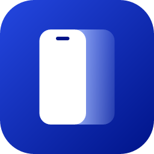

# Reflex



Mirror and control your phone's screen on your PC. **Free, open source, no time limits**: no accounts, no ads, no watermarks.

Written in Rust. Runs on Windows, Linux and macOS. Available in English and Spanish (it follows your system language and can be changed in Settings).

| Platform | Status |
|---|---|
| Android (USB and Wi-Fi) | Available |
| Android, cast from the phone (Miracast or Reflex app) | Planned |
| iPhone / iPad (AirPlay) | In development, see [docs/IPHONE.md](docs/IPHONE.md) |

## Features (Android)

- Real-time screen mirroring (H.264, up to 120 fps)
- **Full mouse and keyboard control**: tap, swipe, scroll and type
- **Phone audio on the PC** (Android 11+), optionally also on the phone (Android 13+)
- Connect over **USB cable** or **Wi-Fi**: just type the pairing code, Reflex finds the phone on your network
- The window is the phone itself, with a floating control bar you can hide
- Resize diagonally keeping the phone's shape, or with Ctrl + mouse wheel; the size is remembered
- Back, Home, Recents, volume, power, rotate and notifications
- **Screenshots** (PNG) and **recordings** (MP4, original quality, no re-encoding)
- Shared clipboard: Ctrl+C / Ctrl+V between PC and phone
- Turn off the phone's screen while you keep mirroring
- Full screen (F11)
- Nothing to install on the phone

## Getting started

1. Download Reflex from [Releases](../../releases) and open it.
2. The first time, click **Download and start** (Google's adb and the scrcpy server, about 15 MB).
3. Enable **Developer options** on the phone: *Settings, About phone*, tap *Build number* 7 times.

### Wireless (Android 11+)

1. Connect the phone to the same Wi-Fi as your PC.
2. In *Developer options*, turn on *Wireless debugging*, open it and tap **Pair device with pairing code**.
3. In Reflex choose **Wireless** and type the 6-digit code. Done.

### With a cable

1. In *Developer options*, turn on *USB debugging*.
2. Plug in the cable, accept the prompt on the phone and click **Mirror**.

On Xiaomi, Redmi and POCO also enable *USB debugging (Security settings)* or touches will not work.

### Controls

| On the PC | On the phone |
|---|---|
| Left click / drag | Tap / swipe |
| Right click | Back (or wake the screen) |
| Middle click | Home |
| Mouse wheel | Scroll |
| Keyboard | Type (click the screen first) |
| Ctrl+V | Paste the PC clipboard on the phone |
| Ctrl+C | Copy the phone selection to the PC |
| Ctrl + mouse wheel | Make the phone bigger or smaller |
| F11 / Esc | Full screen / exit |

Screenshots are saved to `Pictures/Reflex` and recordings to `Videos/Reflex`.

## Building

You need [Rust](https://rustup.rs) 1.88 or newer and a C/C++ compiler (on Windows, the Visual Studio Build Tools).

```sh
cargo build --release
```

The executable ends up in `target/release/`. On Linux you also need the ALSA headers (`libasound2-dev`).

Tests: `cargo test` (some use `ffmpeg`, if installed, to generate real H.264 video).

## How it works

```
┌──────────── PC (Reflex, Rust) ────────────┐        ┌────── Android ──────┐
│ egui  ←  OpenH264  ←  video socket  ←─────┼─ adb ──┼── scrcpy-server     │
│ cpal  ←  PCM 48 kHz ← audio socket  ←─────┼ tunnel ┼── (MediaCodec,      │
│ mouse/keyboard → control socket ──────────┼───────→┼──  AudioRecord,     │
└───────────────────────────────────────────┘        │    InputManager)    │
                                                     └─────────────────────┘
```

- `src/adb.rs`: device list, Wi-Fi, pairing, network discovery and tunnel.
- `src/android/`: server startup and binary protocol (video, audio and control).
- `src/video.rs`: H.264 decoding with OpenH264.
- `src/audio.rs`: audio playback with cpal.
- `src/recorder.rs`: MP4 recording.
- `src/app.rs`: user interface. `src/i18n.rs`: languages. `src/window.rs`: borderless window on Windows.

On the phone Reflex uses the [scrcpy](https://github.com/Genymobile/scrcpy) v5.0.1 server, downloaded from its official release and checked against its SHA-256. Everything on the PC side (interface, decoding, control, audio, recording) is Reflex's own code.

## Brand

Icon, colours, typography and voice are in the [brand manual](docs/marca/README.md) (Spanish).

## License

[GPL-3.0-or-later](LICENSE): you can use, study, modify and share Reflex, as long as you keep the author's credit and any version you distribute stays open source under the same license. Third-party components are listed in [THIRD_PARTY.md](THIRD_PARTY.md).

Reflex is an independent project, not affiliated with Apowersoft, Apple, Google or Genymobile.
