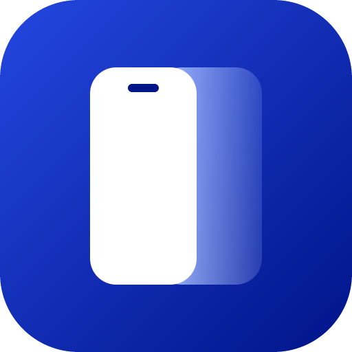

# Reflex: manual de marca

Reflex duplica y controla la pantalla del móvil en el PC. Es libre, open source y no tiene límite de tiempo. Este manual fija cómo se ve y cómo habla.

## La idea

El nombre y el símbolo cuentan lo mismo: lo que pasa en el móvil aparece en el PC, como en un espejo. El icono es un móvil blanco con su reflejo detrás, que se desvanece hacia la derecha como en un cristal. No lleva letras dentro: tiene que leerse igual a 16 px en la barra de tareas que a 512 px.

## Logotipo e icono

- **Icono** ([`assets/icon.svg`](../../assets/icon.svg)): baldosa cuadrada con esquinas de 228/1024, degradado de `reflex-blue-bright` a `reflex-blue`, móvil en `phone-white` y reflejo en `ice` con opacidad de 1 a 0,18.
- **Logotipo**: el icono seguido de la palabra «Reflex» en Sora 600, color `ink`. La altura de la palabra es el 60 % del lado del icono.
- Espacio de respeto: un cuarto del lado del icono alrededor.
- No se gira, no se cambia de color, no se le añade sombra, contorno ni texto, y el reflejo no se separa del móvil.
- Tamaños: el .ico de Windows lleva 16, 24, 32, 48, 64, 128 y 256 px, generados desde el SVG con `cargo run --example make_icon`.

## Color

El azul es Pantone Reflex Blue C (`reflex-blue`, #001489): el nombre de la marca es también el nombre de su color. Es el único color de identidad. `ice` es el reflejo y solo decora. `rec` se reserva para el estado de grabación.

- Texto principal: `ink` sobre `surface` o `surface-raised`. Secundario: `muted`.
- Botón principal: fondo `reflex-blue`, texto `phone-white`; al pasar el ratón, `reflex-blue-bright`.
- En tema oscuro, `reflex-blue` se aclara a #7088FF para que enlaces y bordes se lean sobre `surface`.
- La app usa tema oscuro por defecto: la pantalla del móvil es la protagonista y el fondo oscuro la enmarca sin competir.

## Tipografía

- **Sora** (display): el nombre, títulos y encabezados. Geométrica y ancha, como la silueta del móvil.
- **Inter** (texto): todo lo demás en la interfaz y la web.
- **JetBrains Mono** (datos): resolución, fps, direcciones IP con puerto (`192.168.1.40:5555`) y números de serie.

## Forma y espacio

- Esquinas: `radius-md` en botones y tarjetas, `radius-xl` en el marco del móvil.
- Ritmo de 4 px, de `space-1` a `space-6`. Margen lateral mínimo `space-4`.
- Sin sombras de colores ni degradados fuera del icono.

## Voz

Reflex habla como un amigo que sabe de móviles: en español de España, de tú, directo y sin tecnicismos cuando no hacen falta.

- Di lo que pasa y qué hacer: «Acepta el aviso ¿Permitir depuración USB? en el móvil», no «Dispositivo no autorizado».
- Botones con verbo: «Duplicar», «Pasar a Wi-Fi», «Emparejar», «Grabar».
- Nada de «gratis por tiempo limitado», ni cuentas, ni mayúsculas para gritar.
- Lo libre se dice una vez y sin sermón: «Libre, open source y sin límite de tiempo».

## Iconografía

Los botones de la barra usan símbolos Unicode sencillos (◀ ⌂ ▤ ⟳ ⏺) junto a su texto. El texto nunca se quita: el símbolo acompaña, no sustituye.

## Archivos

- [`tokens.json`](tokens.json): colores, tipografía, espaciado y esquinas en formato de tokens.
- [`assets/icon.svg`](../../assets/icon.svg): icono vectorial, fuente de todos los tamaños.
- [`assets/reflex.ico`](../../assets/reflex.ico): icono de Windows.
